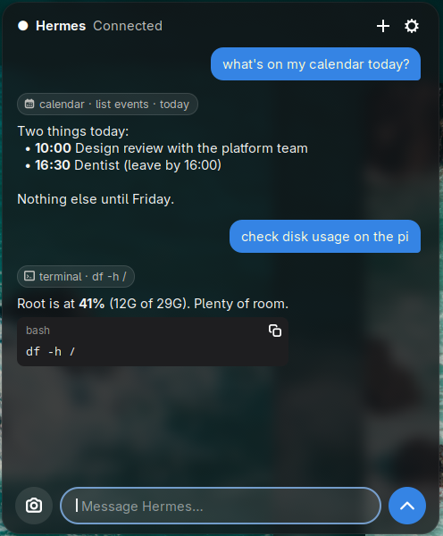

# Hermes for GNOME

Chat with your [Hermes Agent](https://github.com/NousResearch/hermes-agent) from the GNOME top bar. It connects to Hermes on the same machine or on another box on your network, such as a Raspberry Pi over Tailscale.

<p align="center"></p>

## Features

- **Streaming chat** with Markdown: headings, lists, emphasis, inline code, and code blocks with a copy button.
- **Tool calls as chips.** You see which tools the agent is running (terminal, web, files, calendar…), live, and whether each one succeeded.
- **Inline approvals.** When Hermes wants to run a dangerous command you get Allow / Deny buttons in the chat.
- **Screenshot attach.** The camera button captures your screen and sends it with your message, for vision-capable models.
- **Top-bar status:**
  - a green dot when connected, red when offline;
  - animated dots while a reply is generating;
  - a pulsing badge when a reply finishes while the popup is closed.
- **Persistent conversation.** It survives closing the popup, logging out and rebooting. **+** starts a new chat. Chats are regular Hermes sessions, so they also show up in `hermes sessions` and the dashboard.
- **Stop** interrupts a running reply.

Requires GNOME Shell 48–51 and Hermes Agent with the API server enabled.

## Setup

### 1. Enable the Hermes API server

On the machine running Hermes, add to `~/.hermes/.env`:

```sh
API_SERVER_ENABLED=true
API_SERVER_KEY=<long random string>   # e.g. openssl rand -hex 32
```

Then restart the gateway: `systemctl --user restart hermes-gateway`. The server listens on `127.0.0.1:8642`.

### 2. Make it reachable (remote machines only)

The API server only listens on localhost. The easiest way to reach it from your laptop is [Tailscale Serve](https://tailscale.com/kb/1312/serve). It adds HTTPS and keeps the server private to your tailnet:

```sh
tailscale serve --bg --https=8642 http://127.0.0.1:8642
# → https://<machine>.<tailnet>.ts.net:8642
```

The first time, Tailscale prints a link to enable Serve for your tailnet.

### 3. Install the extension

```sh
git clone https://github.com/funinkina/hermes-gnome-extension.git
cd hermes-gnome-extension
glib-compile-schemas schemas
ln -s "$PWD" ~/.local/share/gnome-shell/extensions/hermes@funinkina.com
```

Log out and back in (Wayland can't load new extensions live), then:

```sh
gnome-extensions enable hermes@funinkina.com
```

### 4. Configure

Open the settings with the ⚙ button in the popup or `gnome-extensions prefs hermes@funinkina.com`:

| Setting | Hermes on this machine | Hermes on another machine |
|---|---|---|
| Server URL | `http://127.0.0.1:8642` | `https://<machine>.<tailnet>.ts.net:8642` |
| API key | your `API_SERVER_KEY` | same |

Press **Test** to check the connection.

> The API key is stored unencrypted in GSettings (dconf). Use HTTPS (e.g. Tailscale Serve) for anything that isn't localhost.

## Limitations

- **Slash commands** (`/model`, `/compress`…) aren't supported. Hermes' API server sends them to the model as plain text; real command execution needs the dashboard's websocket gateway.
- Screenshots in old messages show only their text after a reload, because Hermes stores just the text part.

## Development

```sh
gjs -m test-markdown.js                          # markdown renderer self-check
dbus-run-session gnome-shell --devkit --wayland  # full GNOME Shell in a window, loads current code
dev/shot.sh /tmp/shot.png                        # headless shell: render a fixture chat + screenshot
journalctl -f -o cat /usr/bin/gnome-shell        # extension logs
```

On Wayland your running session keeps the code it loaded at login. Use the devkit window to iterate, and log out to pick up changes for real. `dev/shot.sh` runs against a throwaway copy of your dconf, so it never touches your real settings.

| File | Role |
|---|---|
| `api.js` | HTTP + SSE client for the Hermes API server (`/api/sessions/{id}/chat/stream`, `/v1/runs/{id}/approval` and `/stop`) |
| `markdown.js` | Markdown → Pango markup, safe for partial (streaming) input |
| `extension.js` | Top-bar indicator and chat UI |
| `prefs.js` | Settings window |

## License

MIT, see [LICENSE](LICENSE). The panel icon is derived from the Hermes Agent app icon, © Nous Research, MIT ([icons/LICENSE-hermes-agent](icons/LICENSE-hermes-agent)).
